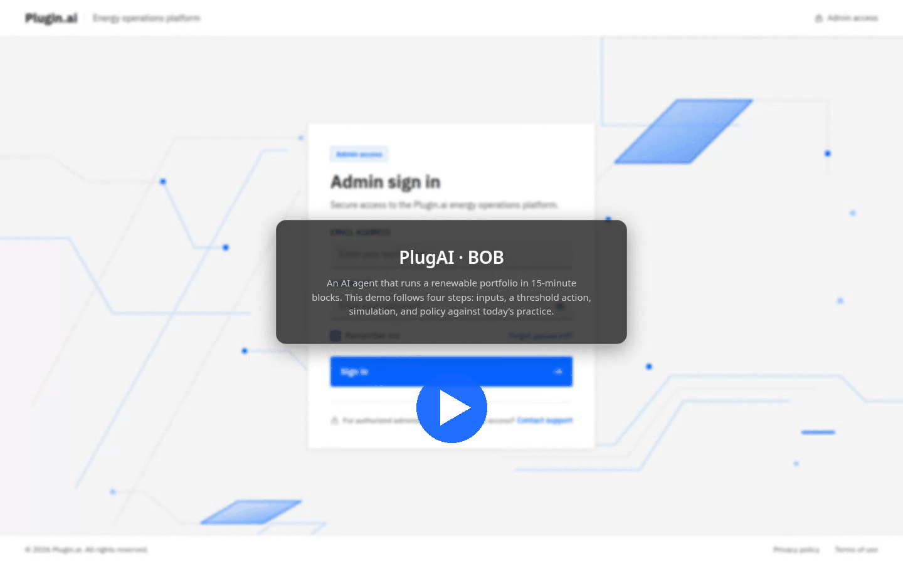

# PlugAI — Renewable Energy Orchestrator

A demo of BOB, an AI agent that orchestrates a renewable energy portfolio (solar, wind, batteries, industrial demand, grid and market) in 15-minute blocks. The client is React + TypeScript with Tailwind; the API is FastAPI on PostgreSQL.

[](https://github.com/user-attachments/assets/24b43eee-65d0-4478-bbab-091e6796e9a9)

The [user manual](docs/user-manual.md) walks through every screen.

```text
browser ──> Vite :5173 (web/) ──/api──> FastAPI :8000 (server/) ──┐
                                                                  ├──> PostgreSQL 16 :5432
                             worker: simulation clock (server/) ──┘
```

## System requirements

| | Minimum | Recommended |
| --- | --- | --- |
| OS | Ubuntu 22.04+ / Debian 12+ (or another 64-bit Linux), Windows 10 22H2 or 11 (64-bit) | Same |
| CPU | 2 cores, x86-64 or ARM64 | 4+ cores: each live block solves several plans in a pool of `SOLVER_PROCESSES` (default 4) |
| Memory | 4 GB free | 8 GB free (the API, the worker and its solver pool, PostgreSQL and Vite together) |
| Disk | 2 GB free | Dependencies take about 0.8 GB (`web/node_modules` 0.6 GB, `server/.venv` 0.25 GB), plus Docker's PostgreSQL image |
| Network | Needed for the install only | The language model (optional) needs access to Azure OpenAI |

Build tools:

| Tool | Version | Used for |
| --- | --- | --- |
| Git | any recent | cloning the repository |
| Python | 3.12 or newer, with `venv` and `pip` | API, worker, migrations, seed, tests |
| Node.js and npm | 20.19+ or 22.12+ (Vite 6) | the client: dev server and `npm run build` |
| PostgreSQL | 16 | via Docker (`docker compose`) or a local install |
| Docker Engine with Compose v2, or Docker Desktop | any recent | runs PostgreSQL; optional if PostgreSQL is installed locally |
| GNU Make | 4.x | the `make` shortcuts on Linux; optional |

Every Python and npm dependency installs from prebuilt wheels and packages on x86-64 and ARM64, so no C compiler is needed. If `pip` ever falls back to building from source (an unusual Python version or CPU), install `build-essential` and `python3-dev` on Linux, or the *Microsoft C++ Build Tools* on Windows.

## Linux setup

Install the tools (Ubuntu or Debian shown; use Docker's own instructions for Docker Engine):

```sh
sudo apt update
sudo apt install -y git make python3 python3-venv python3-pip
# Node.js 22 LTS, for example through nvm:
curl -o- https://raw.githubusercontent.com/nvm-sh/nvm/v0.40.3/install.sh | bash
nvm install 22
```

Check that `python3 --version` reports 3.12 or newer; on older distributions install `python3.12` and `python3.12-venv` and run Make with `PYTHON=python3.12`.

Then, from the repository root:

```sh
make setup      # server/.env and web/.env from the examples (never overwritten), npm install, Python venv
make db-up      # PostgreSQL 16 in Docker, with the databases bob and bob_test
make migrate    # apply the database migrations (alembic upgrade head)
make seed       # the demo portfolio (9 sites, 19 assets) and the Demo story run; safe to repeat
```

Without Make, the same steps are:

```sh
cp -n server/.env.example server/.env
cp -n web/.env.example web/.env
(cd web && npm install)
(cd server && python3 -m venv .venv && .venv/bin/python -m pip install -r requirements.txt)
docker compose up -d --wait
(cd server && .venv/bin/python -m alembic upgrade head)   # migrate
(cd server && .venv/bin/python -m app.seed)               # seed
```

Run the API, the simulation worker and the client, each in its own terminal:

```sh
make server-dev   # or: cd server && .venv/bin/python -m uvicorn app.main:app --reload
make worker       # or: cd server && .venv/bin/python -m app.worker
make web-dev      # or: cd web && npm run dev
```

## Windows setup

```text
winget ──> Python 3.12, Node LTS, Git, PostgreSQL 16 (or Docker Desktop)
psql   ──> role bob + databases bob, bob_test
server ──> .env, .venv, migrate, seed ──> API :8000 + worker
web    ──> .env, npm install ──> Vite :5173
```

Use PowerShell from the repository root. Install the tools (the PostgreSQL installer asks for a password for the `postgres` superuser), then open a new terminal so they are on `PATH`:

```powershell
winget install Git.Git Python.Python.3.12 OpenJS.NodeJS.LTS PostgreSQL.PostgreSQL.16
```

If PowerShell reports that running scripts is disabled when you call `npm`, allow local scripts once:

```powershell
Set-ExecutionPolicy -Scope CurrentUser RemoteSigned
```

Create the role and databases. With Docker Desktop instead of a local PostgreSQL, skip this and run `docker compose up -d --wait`, which creates them.

```powershell
& "C:\Program Files\PostgreSQL\16\bin\psql.exe" -U postgres `
  -c "CREATE ROLE bob LOGIN PASSWORD 'bob'" `
  -c "CREATE DATABASE bob OWNER bob" `
  -c "CREATE DATABASE bob_test OWNER bob"
```

Install the dependencies, migrate and seed:

```powershell
cd server
Copy-Item .env.example .env
py -3.12 -m venv .venv
.venv\Scripts\python -m pip install -r requirements.txt
.venv\Scripts\python -m alembic upgrade head    # migrate
.venv\Scripts\python -m app.seed                # seed (safe to repeat)
cd ..\web
Copy-Item .env.example .env
npm install
cd ..
```

Then run each of these in its own terminal from the repository root:

```powershell
cd server; .venv\Scripts\python -m uvicorn app.main:app --reload   # API
cd server; .venv\Scripts\python -m app.worker                      # simulation clock
cd web; npm run dev                                                # client
```

## Use it

Open `http://localhost:5173`, create an account and sign in. The seed has already started the **Demo story** run: it fast-forwards to 10:45, then settles one 15-minute block every 30 s. The API runs at `http://localhost:8000`, with interactive docs at `/docs`; the client has no run controls, so start a new run, pause, step, change speed or inject events there (see the [manual](docs/user-manual.md#3-the-simulation)).

Every block, BOB reads the situation, picks an operating mode, builds up to five plans with a mixed-integer optimiser (HiGHS), stress-tests them, and executes the first block of the plan with the least worst-case regret. It acts only at sites whose telemetry feed is connected: every seeded site is connected except **Kuppam Solar Site (`KUP-SOLAR-001`)**, so connecting it on its Connect data page is the demo's first step. The same day is also settled with today's rule-based practice, and the portfolio compares the two.

Commands from the repository root (Windows equivalents in brackets):

| Task | Linux | Windows (PowerShell) |
| --- | --- | --- |
| Migrate | `make migrate` | `cd server; .venv\Scripts\python -m alembic upgrade head` |
| Seed | `make seed` | `cd server; .venv\Scripts\python -m app.seed` |
| Backend tests (needs the database) | `make test` | `cd server; .venv\Scripts\python -m pytest` |
| Colour-token check | `make check-colors` | `cd web; npm run check:colors` |
| Production build of the client | `make build` | `cd web; npm run build` |
| Stop PostgreSQL (data kept) | `make db-down` | `docker compose down` |
| Start from a clean database | `docker compose down -v && make db-up migrate seed` | `docker compose down -v; docker compose up -d --wait`, then migrate and seed (local PostgreSQL: drop and recreate the `bob` database) |

The worker does not reload code: restart it after pulling changes. Several workers can run at once; each block is settled exactly once.

## Configuration

- `server/.env.example` documents API settings. With `ENV=local` and no `SECRET_KEY`, the API generates a signing key per process, so tokens stop working after a restart. Any other `ENV` requires a stable `SECRET_KEY` of at least 32 characters.
- `DATABASE_URL` is a SQLAlchemy URL for PostgreSQL (`postgresql+psycopg://…`). Tests use `TEST_DATABASE_URL`, defaulting to the `bob_test` database.
- `CORS_ORIGINS` is a comma-separated list of browser origins, defaulting to `http://localhost:5173`.
- `web/.env.example` points the client at `/api` on its own origin, which Vite proxies to `http://localhost:8000`, and every call carries the bearer token.

## API

| Method | Path | Purpose |
| --- | --- | --- |
| `POST` | `/api/auth/register` | Create an account; returns an access token and user |
| `POST` | `/api/auth/login` | Validate email/password; returns an access token and user |
| `GET` | `/api/auth/me` | The authenticated user |
| `GET` | `/api/portfolio` | Portfolio totals and site summaries |
| `GET` | `/api/sites/{code}` | One site with its assets and parameters |
| `GET` | `/api/runs/presets` | Scenario presets |
| `GET` / `POST` | `/api/runs/current`, `/api/runs` | Latest run; start a run from a preset |
| `POST` | `/api/runs/{id}/pause`, `/play`, `/step` | Clock controls (step only while paused) |
| `PATCH` | `/api/runs/{id}` | Speed (10, 30 or 60×) |
| `POST` | `/api/runs/{id}/events` | Inject a world event |
| `GET` | `/api/runs/{id}/sites/{code}/live` | Site live overview |
| `GET` | `/api/runs/{id}/summary` | BOB vs today's practice totals |
| `GET` | `/api/runs/{id}/actions` | BOB's latest actions |
| `GET` | `/api/runs/{id}/decisions/latest`, `/api/runs/decisions/{cycle}` | Latest decision; full decision record |
| `POST` | `/api/runs/{id}/actions/{action}/approve`, `/decline` | Decide a gated action before its deadline |
| `GET` | `/api/runs/{id}/events?after=` | Fired world events (for notifications) |
| `GET` / `POST` | `/api/sites/{code}/configs`, `/api/sites/{code}/config-options` | Configured actions; save a draft |
| `POST` / `PATCH` | `/api/configs/{id}/test`, `/activate`; `/api/configs/{id}` | Test and activate a draft; pause or resume |
| `POST` | `/api/data-sources/connect` | Connect a site's telemetry, forecast or price feed |
| `GET` | `/api/mock/sites/{code}/telemetry`, `/api/mock/portfolio/forecast`, `/api/mock/market/prices` | The simulated feeds (no token needed) |

All other endpoints except register and login need `Authorization: Bearer <token>`. In `/docs`, call `POST /api/auth/login`, copy `access_token`, and paste it under **Authorize**.

## Project layout

```text
web/
  src/api/           Typed API client and token store
  src/auth/          Signed-in user
  src/runs/          Run state hooks
  src/*.tsx          Screens: portfolio (App.tsx), site, live overview, connect data, Configure BOB, Ask BOB
server/
  app/api/           HTTP routes and auth dependencies
  app/core/          Settings, database and security
  app/models/        SQLAlchemy entities
  app/schemas/       Request/response models and asset parameter validation
  app/services/      Business logic
  app/seed.py        Demo portfolio seed
  app/sim/           Simulated world: presets, truth, forecasts, plant settlement, market rules, mock adapters
  app/optimize/      Dispatch optimiser, validator, today's-practice rules
  app/worker.py      Simulation clock worker
  migrations/        Alembic migrations
  tests/             API tests against PostgreSQL
```
