# PlugAI user manual

[](demo/bob-demo.webm)

*Click the picture to play the demo video ([`docs/demo/bob-demo.webm`](demo/bob-demo.webm), 3 min 26 s).*

PlugAI runs a simulated renewable energy portfolio in Andhra Pradesh (solar, wind, two batteries, an industrial cluster and a market connection) in 15-minute blocks. **BOB** is its AI operator. Every block it plans what each asset should do, acts within the limits you set, asks you when an action is above its authority, and explains every decision. Each run is also settled under **today's practice**: batteries on a fixed clock and a trading desk. That gives you a fair comparison on the same weather and prices.

```text
 top bar: Portfolio · AI recommendations · Ask BOB
   │
 Portfolio ──► Open site ──► Site details ◄──► Live overview (live data feed)
   │                │                              │
   │                ├─ Connect data ◄──────────────┘  (telemetry · forecast · prices)
   │                └─ BOB tab: Configure BOB ──► Add / edit action ──► setup wizard
   │                                                  Select → Configure → Test → Activate
   │                                                                          │
   │                                                       Live monitoring ◄──┘ ──► Approvals
   ├─ AI recommendations (approve · decline · open site)
   └─ Ask BOB (questions · what-if · draft an action)

 run clock, presets, events ──► API docs at http://localhost:8000/docs
```

Everything is simulated: weather, prices, plants, grid, market and maintenance systems. Nothing connects to a real asset.

## 1. Start the application

Set up and start the app as the [README](../README.md) describes for Linux or Windows. In short, on Linux:

```sh
make setup && make db-up && make migrate && make seed
make server-dev   # terminal 1: API on http://localhost:8000
make worker       # terminal 2: the simulation clock
make web-dev      # terminal 3: the app on http://localhost:5173
```

**BOB's language model (optional).** Put the Azure OpenAI endpoint, key and deployment name in `server/.env`, then restart the API and the worker:

```
MICROSOFT_AZURE_OPENAI_ENDPOINT=…
MICROSOFT_AZURE_OPENAI_KEY=…
MICROSOFT_AZURE_OPENAI_DEPLOYMENT_NAME=…
```

Without them everything still works: the optimiser and rules make every decision, and Ask BOB explains that it is offline.

## 2. Sign in

Open http://localhost:5173. Create an account the first time, then sign in with your work email and password.

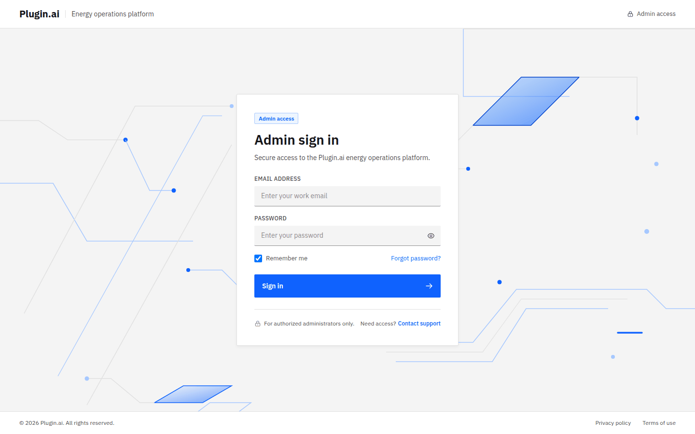

## 3. The simulation

`make seed` starts the **Demo story** run, so the app is live as soon as you sign in. A run fast-forwards to 10:45 and then runs live: at the default 30× speed a 15-minute block settles every 30 seconds.

The app has no run controls; use the API docs at http://localhost:8000/docs. Call `POST /api/auth/login`, copy `access_token`, click **Authorize** and paste it. Then:

| To | Call | Body |
| --- | --- | --- |
| Start a scenario (ends the previous run) | `POST /api/runs` | `{"preset": "demo_story"}` |
| Pause, play, step one block while paused | `POST /api/runs/{id}/pause`, `/play`, `/step` | none |
| Change speed | `PATCH /api/runs/{id}` | `{"speed": 60}` (10, 30 or 60) |
| Inject an event now | `POST /api/runs/{id}/events` | for example `{"kind": "cloud_bank", "node": "SOUTH", "depth": 0.6, "minutes": 120}` |

`GET /api/runs/current` gives the run's `id`.

| Scenario (`preset`) | What happens |
| --- | --- |
| Demo story (`demo_story`) | The full story in one day: cloud bank, evening price spike, Battery 2 trip, north corridor derate, then a storm bulletin for an afternoon storm, with maintenance calendared inside it |
| Calm day (`calm_day`) | Normal conditions: battery arbitrage against the fixed clock |
| Evening spike (`evening_spike`) | Real-time prices rise 50 % from 18:00 to 22:00 |
| Congestion (`congestion`) | A windy afternoon fills the north corridor |
| Storm day (`storm_day`) | The storm story on its own |

Events are `cloud_bank`, `wind_ramp`, `storm`, `price_spike`, `bess_trip`, `line_derate`, `demand_surge`, `frequency_dip` and `forecast_update`; `/docs` shows each one's fields. BOB re-plans the block in progress as soon as it can see an event.

## 4. Portfolio

The landing page shows the whole portfolio at the current simulated time.

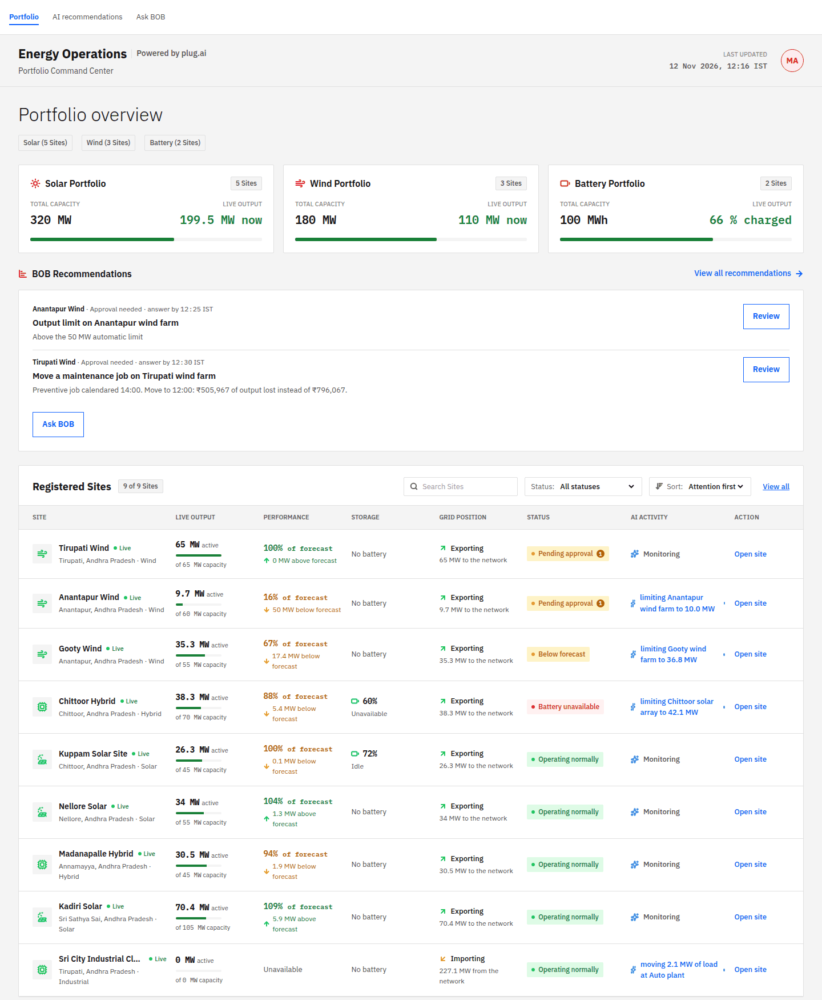

- **Solar, wind and battery cards** show each fleet's capacity and live output or charge.
- **BOB Recommendations** lead with the decisions that wait for you, each with its deadline. **Review** opens AI recommendations; **Ask BOB** opens the chat.
- **Registered Sites** lists each site's live output against capacity, output against forecast, battery charge, grid position (exporting or importing), status and what BOB is doing there. Search, filter by status and sort by attention, name or output. **Open site** opens the site.
- **Transaction History** lists every action, who initiated it (BOB or a person) and its status. Filter it by initiator or search it by ID.

## 5. A site

### Site details

Identity, owner, contact, location and the site's **assets**, with each asset's monitoring state and the actions BOB is permitted to take on it. The header shows whether BOB is active, whether the site's data is connected, and the operating mode.

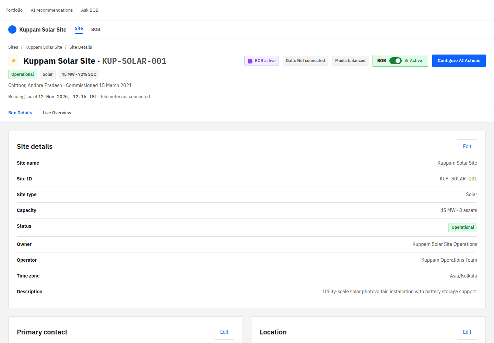

### Live overview and the live data feed

The **Live data feed** panel shows the readings BOB receives for this site, refreshed every block: irradiance, wind, ambient temperature, grid frequency, generation and each battery's charge.

BOB **acts only at sites whose telemetry is connected**. At an unconnected site it still counts the site's assets in its plan, but sends them no commands; the panel says *BOB is only watching this site* and offers **Connect data**. Every seeded site is connected except **Kuppam Solar Site**, so you can see the difference.

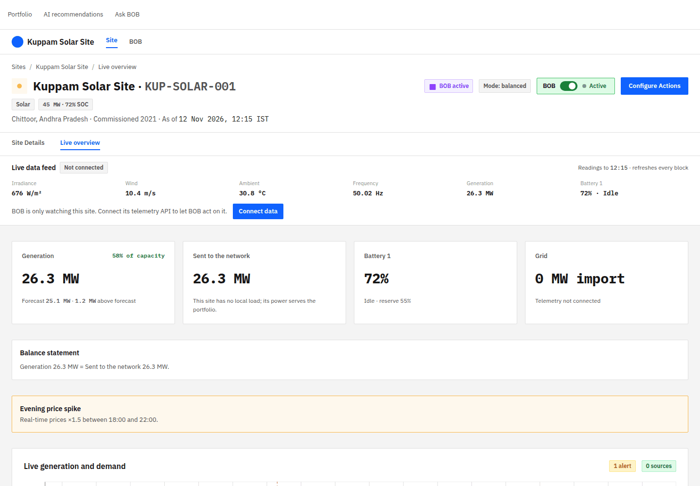

Once connected, the panel shows what BOB is doing at the site this block and, when the feed reported a surprise (a plant well off its forecast), the reason for the latest re-plan.

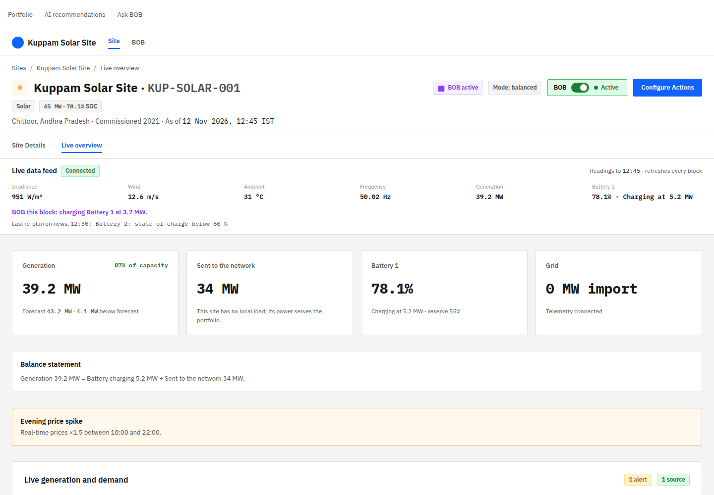

Below the panel: generation, power sent to the network, battery and grid cards; the balance statement; alerts such as an announced price spike; the generation chart (actuals so far, then the forecast with its P10–P90 range and BOB's planned battery power); conditions; and the energy flow.

### Connect data

**Connect data** (from the Live overview, the site header or Live monitoring) connects the three feeds BOB works from. Enter the endpoint and click **Test Connection**: a successful test connects the feed and shows the rows exactly as the API sends them. The API key is not stored.

| Feed | Simulated endpoint | What it returns |
| --- | --- | --- |
| Site telemetry | `http://localhost:5173/api/mock/sites/KUP-SOLAR-001/telemetry` (use the site's own code) | The last three hours, one row per asset per settled block: power, availability, battery charge, irradiance, wind, temperature, frequency |
| Demand and renewables forecast | `http://localhost:5173/api/mock/portfolio/forecast` | Demand and renewable availability (P50) for the next 24 hours |
| Market prices | `http://localhost:5173/api/mock/market/prices` | The real-time price forecast (P10, P50, P90) and the day-ahead price for the next 24 hours |

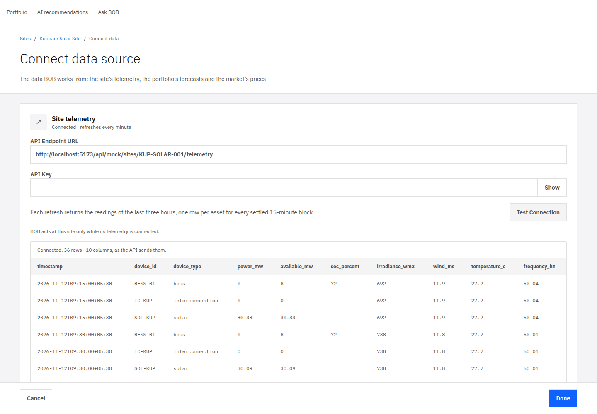

Only the telemetry feed changes what BOB may do; the forecast and price feeds are kept as the site's sources and show the same data BOB plans on.

## 6. Recommendations and approvals

BOB acts alone only within each action's **automatic limit**. Anything larger, or anything set to need approval, waits for you on **AI recommendations** (top bar), on the portfolio's BOB Recommendations card, and in the site's Live monitoring.

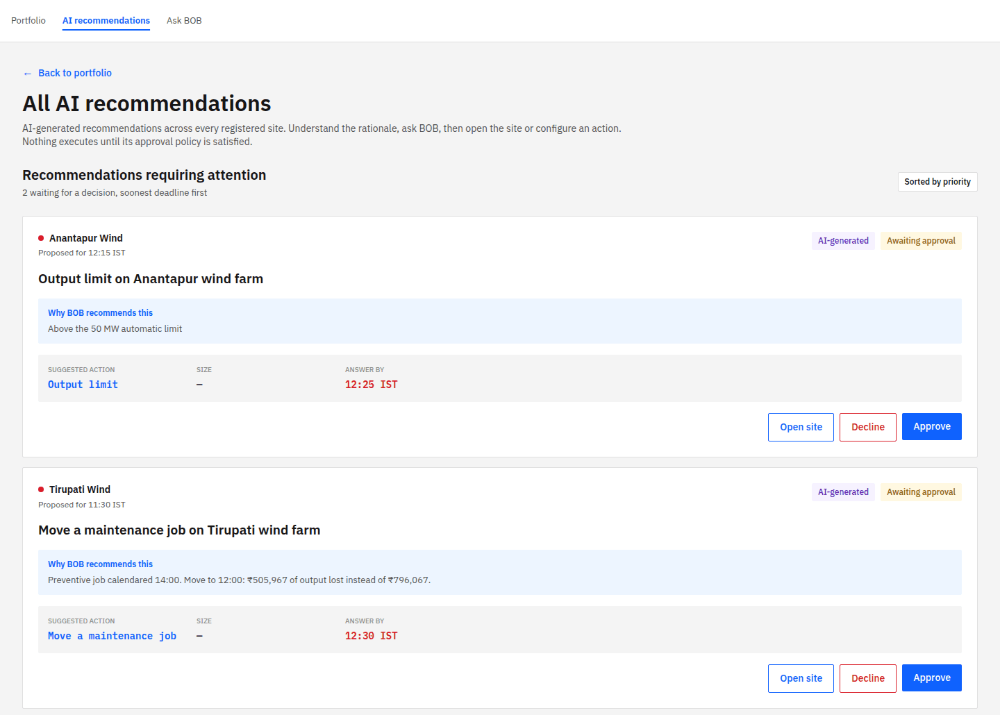

Each card shows the site, what BOB proposes, **why**, and the deadline in simulated time.

- **Approve** sends it. It replaces BOB's fallback action of the same kind.
- **Decline**, or letting the deadline pass, keeps the fallback. While an action waits, BOB still does as much as it may do alone: for example, it buys up to its 60 MW limit while a larger purchase waits for you.
- **Open site** opens the site for context.

## 7. Live monitoring

After you activate an action (section 8), **Open live monitoring** shows the site in operation: what BOB is doing now and its power balance, the battery's charge against its reserve and the locked floor, any approval waiting (**Open approvals**), and the audit event log: re-plans with BOB's reason, mode changes and simulator events.

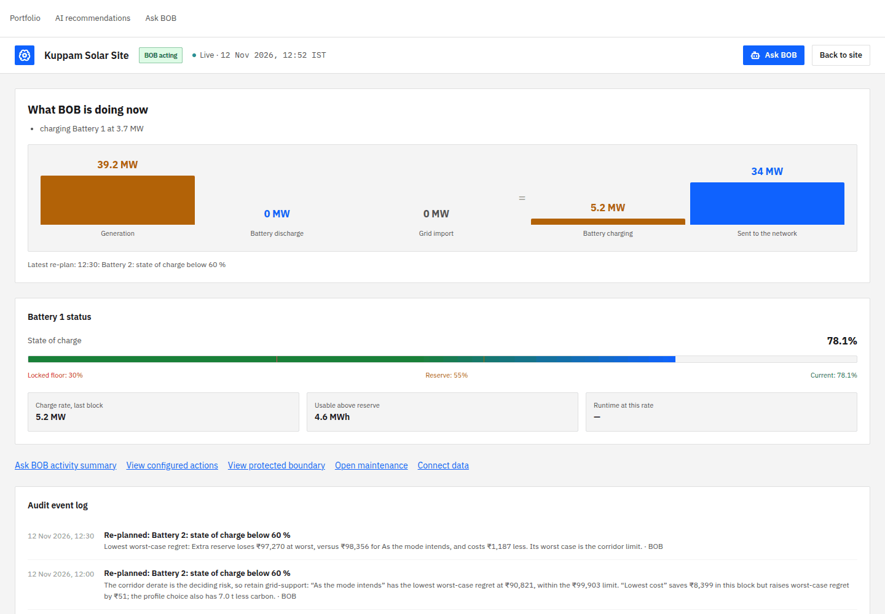

The badge next to the site name reads **BOB acting**, **BOB paused** or **Monitoring only** (telemetry not connected).

## 8. Configure BOB

The site's **BOB** tab lists every action BOB may take there, filtered by All, Active, Paused or Needs attention. Each card shows its status and how often it ran today; switch it off to pause it. Expand a card for its trigger conditions, its effective policy (how BOB acts, the automatic limit, the maximum, the approver and response time) and its recent activity.

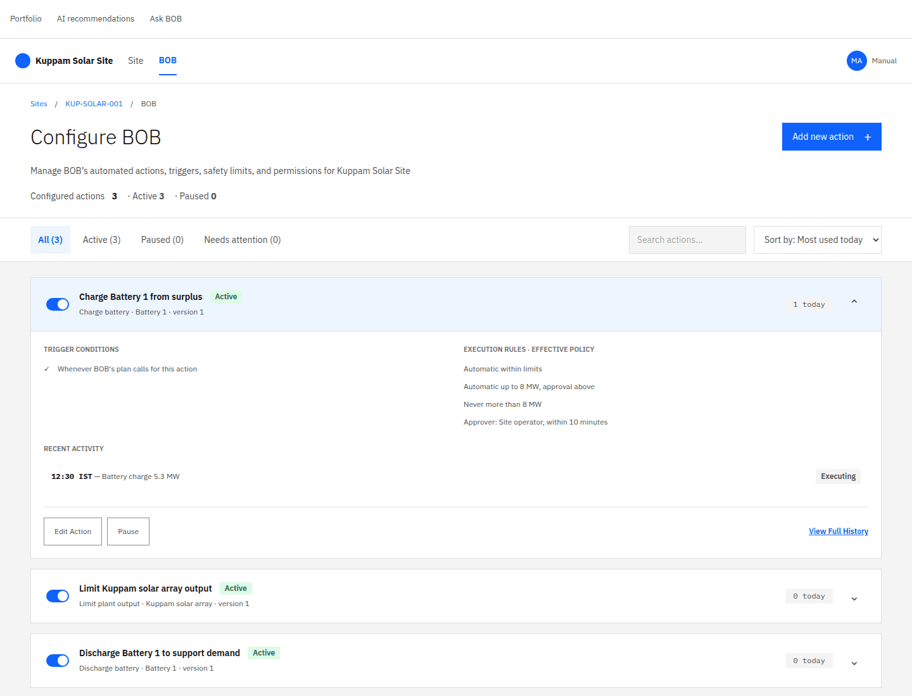

**Add new action** or **Edit Action** opens the setup wizard. Either **Describe it to BOB** in plain words (BOB drafts and tests it) or pick an action and answer the steps:

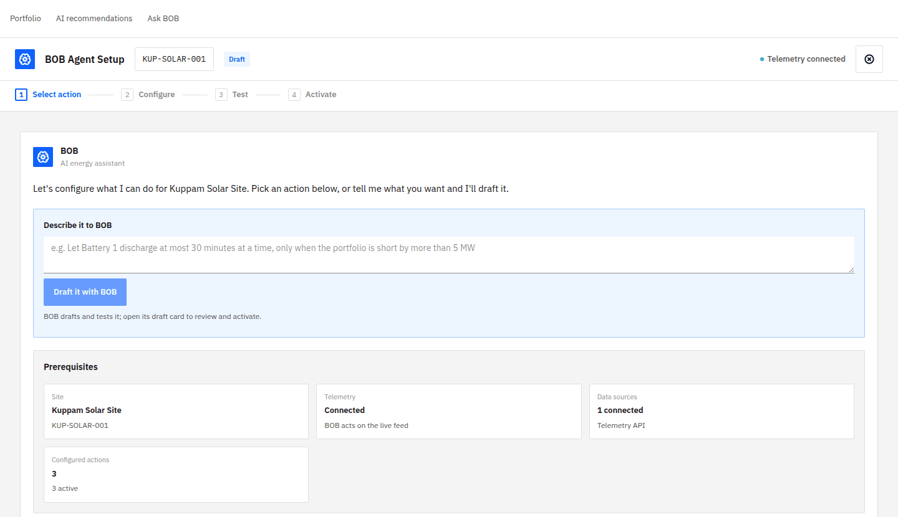

1. **Select action:** the objective, and the asset and action.
2. **Configure:**
   - **When it starts:** whenever BOB's plan calls for it, or only while the portfolio is short of renewables by more than a set amount for a set time.
   - **A watch condition** on another reading. When it is crossed, BOB re-plans once and flags it.
   - **Limits:** automatic up to, never more than, the battery reserve to stop at, the longest continuous discharge and its energy, and the price to sell above.
   - **Autonomy:** recommend only, approval required, or automatic within limits; how long the approver has; what happens on recovery; who is notified.
3. **Test** in the simulator against current conditions, the largest battery being unavailable, and demand at P90. All three must pass; **Edit configuration** goes back.
4. **Activate:** review the changes against the version in force and activate them as a new version, then **Open live monitoring**.

**Protected limits** are organisation rules no setting can loosen: battery reserve never below 30 %, and approval for any action above 100 MW. A setting that breaks one shows **Configuration not accepted** with the allowed range.

## 9. Ask BOB

**Ask BOB** in the top bar is a chat about the whole portfolio. Answers stream in as BOB writes them, from the live run's data. **New chat** starts over.

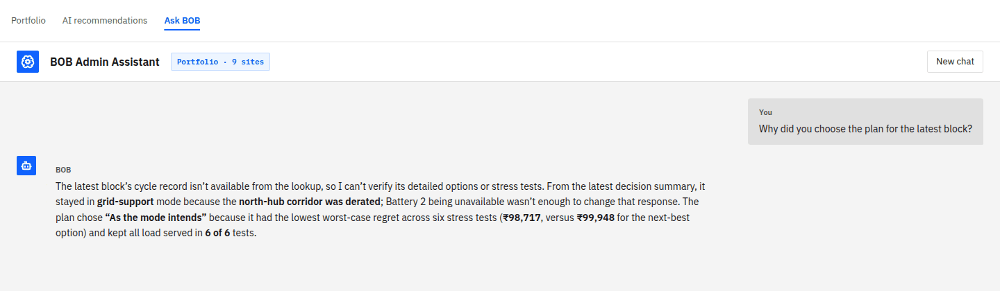

Try these:

- "Why did you choose the plan for the latest block?"
- "Explain action 123."
- "What if Battery 2 trips and demand rises 10 %?" BOB answers with a side-by-side plan. Nothing is executed.
- "Set Battery 1 discharge to run automatically up to 8 MW and test it." BOB drafts the setup and runs its tests. BOB never activates anything itself; a person activates it in the wizard.
- "Remove the minimum battery reserve." BOB explains the protected limit and the allowed range.

## 10. The demo script

The [demo video](demo/bob-demo.webm) follows this path.

1. **Sign in.** The Demo story run is already live (`make seed` started it). The portfolio fills in and the comparison with today's practice builds from the morning.
2. **Open Kuppam Solar Site → Live overview.** The feed says *Not connected*: BOB only watches the site.
3. **Connect data → Site telemetry:** `http://localhost:5173/api/mock/sites/KUP-SOLAR-001/telemetry` → **Test Connection**. Back on the Live overview, within a block or two the panel says **Connected** and *BOB this block: charging Battery 1…*.
4. **11:07 cloud bank** over the south. The connected solar sites report output below forecast; BOB re-plans and the panel names the cause, such as "Nellore solar array 9.2 MW below forecast".
5. **11:10–11:14 price spike, Battery 2 trip, north corridor derate.** Approvals appear on the portfolio and AI recommendations. Approve or decline one.
6. **Kuppam → BOB → Add new action.** Describe a rule to BOB, review its test results and activate it, then **Open live monitoring**.
7. **Ask BOB** why it chose the latest plan, or a what-if.

To repeat the demo, start a new `demo_story` run in `/docs` (section 3). To make Kuppam unconnected again, start from a clean database (README, *Use it*).

## 11. Troubleshooting

| You see | Do this |
| --- | --- |
| Nothing moves; the time does not advance | Start the worker (`make worker`); several workers are fine |
| BOB does nothing at a site | Connect its telemetry on Connect data; the Live data feed must say **Connected** |
| Ask BOB says it is offline | Add the Azure OpenAI settings to `server/.env` and restart the API and worker |
| New behaviour does not show after an update | Restart the worker; it does not reload code |
| A new scenario's events are missing | Start a new run: a run keeps the scenario it started with |
| `make seed` says "Portfolio already exists" | Expected: the seed is safe to repeat. For a clean slate run `docker compose down -v`, then `make db-up migrate seed` |
| Port 5173 is in use | Another Vite project holds it; stop it, or run `npm run dev -- --port 5174` and use that port in the Connect data URLs |

## Glossary

- **Block:** 15 minutes, the Indian market's scheduling interval.
- **Day-ahead / real-time market:** power bought a day ahead, and adjusted in real time up to four blocks before delivery.
- **DSM:** the penalty for drawing more or less than scheduled.
- **P10 / P50 / P90:** low, expected and high forecasts.
- **Nowcast:** BOB pulls the next hours' forecast toward what a connected site's feed reports now, fading over about two hours.
- **Operating mode:** the trade-off BOB plans for (balanced, economic, clean, resilience or grid support).
- **Worst-case regret:** how much an option would lose, in its worst stress scenario, against the best plan for that scenario. BOB chooses the option with the least.
- **Today's practice:** the comparison policy. Batteries charge 10:00–15:00 and discharge 18:00–22:00 on a clock; a desk buys forecast shortfalls; maintenance follows the calendar.
